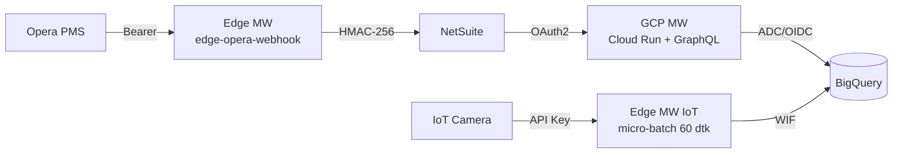

# Distributed Hospitality Ecosystem – Assessment

Ini jawaban saya untuk assessment FINNS. Opera dan NetSuite saya mock. Dari GCP, yang benar-benar saya jalankan hanya BigQuery Sandbox (Module 4); Cloud Run, OIDC, dan Secret Manager baru berupa rancangan.

## Isi repo

| Folder | Isi |
|---|---|
| `edge-opera-webhook/` | Module 1: `server.js`, `edge-webhook.service`, `linux-commands.md`, `mock-netsuite.js` |
| `edge-iot-receiver/` | Module 2: `server.js` (API key dan micro-batching), `edge-iot.service` |
| `gcp-middleware/` | Module 3: schema dan resolver GraphQL, DataLoader, Secret Manager, `Dockerfile` |
| `sql/` | Module 4: `schema.sql`, `conversion_rate_query.sql`, `sample_data/*.jsonl` |
| `docs/` | Diagram Mermaid: arsitektur, alur webhook, alur DataLoader, star schema |

Screenshot hasil uji ada di folder `resultimg/` dan `img_result/` tiap modul.

## Cara menjalankan

Di tiap folder: `cp .env.example .env`, `npm install`, `npm start`. Semuanya jalan di mock mode, tanpa akun GCP atau NetSuite. Untuk Module 1, jalankan juga `npm run mock-netsuite` (tambahkan `FAIL_RATE=0.5` untuk melihat retry). GraphQL ada di `POST localhost:8080/graphql`.

Module 4 di BigQuery Sandbox (tanpa billing): jalankan `sql/schema.sql` sekali, lalu upload tiap file di `sql/sample_data/` ke tabelnya (JSONL, mode Append; `INSERT` diblokir di free tier, load job boleh). Query `sql/conversion_rate_query.sql` memberi 3 transaksi dan 52 pengunjung, jadi conversion rate 5,77%.

## Pengujian dengan ngrok dan webhook.site

ngrok saya pakai untuk membuka webhook lokal ke URL HTTPS publik, seolah-olah Opera memanggil dari luar jaringan (dengan token baru, bukan nilai contoh). Request dijawab 202 di bawah 60 ms, dan body yang dikirim dua kali ditandai `duplicate:true`. Untuk arah sebaliknya, `NETSUITE_URL` saya arahkan ke webhook.site supaya header ke "NetSuite" (`X-Signature`, `X-Timestamp`, `X-Nonce`, `Idempotency-Key`) kelihatan. Tanda tangannya saya hitung ulang dengan `openssl dgst -sha256 -hmac` dan hasilnya sama.

ngrok hanya untuk uji. Di produksi, server Edge sebaiknya di belakang firewall atau reverse proxy hotel dengan TLS dan IP allow-list, atau lewat jalur privat.

## 1. Idempotency (Module 1)

Opera bisa mengirim event yang sama dua kali (misalnya karena retry jaringan), dan pengiriman kita ke NetSuite juga bisa diulang. Supaya tidak tercatat ganda:

1. Tiap event punya key: header `Idempotency-Key` kalau Opera mengirimnya, kalau tidak SHA-256 dari body mentah. (Di produksi sebaiknya pakai ID event atau folio dari Opera, karena dua pesan yang kebetulan identik akan dianggap satu.)
2. Event disimpan dulu ke outbox SQLite dengan key itu sebagai primary key, memakai `INSERT OR IGNORE`. Duplikat tidak masuk, dan webhook tetap menjawab `202` dengan `duplicate:true`. Karena data sudah tersimpan sebelum menjawab, event yang diterima tidak hilang walau server crash.
3. Worker di background menandatangani event (`HMAC-SHA256(secret, timestamp.nonce.body)` di `X-Signature`) lalu mengirimnya ke NetSuite. Sukses jadi `sent`. Timeout, 5xx, atau 429 dicoba lagi dengan exponential backoff plus jitter. 4xx lainnya atau percobaan habis jadi `dead` (dicek manual). Event yang tertahan di `processing` karena crash dikembalikan ke `pending` saat service nyala lagi.
4. Key yang sama ikut dikirim ke NetSuite lewat `Idempotency-Key`, jadi NetSuite bisa membuang kiriman ulang dari kita. Pengirimannya minimal sekali, dan dengan langkah ini efeknya jadi sekali.

## 2. Autentikasi ke BigQuery dari server on-premise (Module 2)

Pilihan saya Workload Identity Federation (WIF) dengan service account impersonation, jadi tidak ada JSON key berumur panjang di server.

- Server edge membuktikan identitasnya ke identity provider yang dipercaya (OIDC IdP on-prem seperti Keycloak, atau sertifikat X.509 lewat mTLS). Google STS menukarnya dengan token berumur pendek yang bertindak sebagai service account khusus, `sa-iot-edge`.
- File konfigurasinya dibuat dengan `gcloud iam workload-identity-pools create-cred-config ... --output-file=wif-credential-config.json` dan tidak berisi rahasia. `GOOGLE_APPLICATION_CREDENTIALS` tinggal diarahkan ke file itu.
- Hak aksesnya minimal: `sa-iot-edge` hanya dapat `roles/bigquery.dataEditor` untuk satu tabel atau dataset, dan attribute condition di pool membatasi host edge yang boleh memakainya.
- Kalau tidak ada IdP, cadangannya service account key di `/etc/...` (mode 600, milik `edgeapp`) yang dirotasi tiap 90 hari. Ini opsi yang lebih lemah.

Micro-batching: tiap request kamera disimpan di buffer SQLite lokal dan langsung dijawab 202. Setiap 60 detik, sebuah timer mengirim sampai 500 baris sekali panggil ke BigQuery, dan baris baru dihapus dari buffer setelah BigQuery mengonfirmasi. Kalau BigQuery tidak terjangkau, data tetap aman dan dicoba lagi di putaran berikutnya. `insertId` diisi `event_id` untuk membantu membuang kiriman ganda (best-effort).

Catatan: BigQuery Sandbox tidak mendukung streaming insert. Untuk pengujian di free tier saya pakai `BQ_MODE=mock`; alternatifnya load job.

## 3. OIDC, IAM, dan Secret Manager di GCP (Module 3)

Untuk deploy GraphQL saya pilih Cloud Run: container stateless, bisa scale to zero, HTTPS sudah tersedia, dan mudah terhubung ke IAM dan Secret Manager. GKE terasa berlebihan untuk satu API. Bagian ini baru rancangan, belum saya deploy ke GCP sungguhan.

- **Tanpa JSON key.** Cloud Run berjalan dengan service account khusus (`sa-graphql-mw`). Library Google mengambil token berumur pendek untuknya dari metadata server (ADC), jadi tidak ada kunci di kode atau repo. Rolenya: `bigquery.dataViewer`, `bigquery.jobUser`, `bigquery.dataEditor` hanya untuk tabel fact NetSuite, dan `secretmanager.secretAccessor` hanya untuk satu secret.
- **Akses masuk.** Deploy dengan `--no-allow-unauthenticated`. Pemanggil (backend BI atau NetSuite) mengirim OIDC ID token yang ditandatangani Google, dengan audience URL service, dan harus punya `roles/run.invoker`.
- **CI/CD.** GitHub Actions masuk lewat WIF (token OIDC GitHub ditukar jadi kredensial sementara), jadi deploy pun tanpa key.
- **Secret Manager.** `tokenUrl`, `clientId`, dan `clientSecret` OAuth2 NetSuite disimpan sebagai satu secret JSON, `netsuite-oauth`. Aplikasi membacanya saat runtime (`secrets.js`), meng-cache 5 menit, menyimpan access token hanya di memori, dan tidak pernah mencatatnya di log. Di produksi versinya dikunci, rotasi dengan menambah versi baru, dan akses terekam di Cloud Audit Logs. Alternatifnya `gcloud run deploy --set-secrets`.

## 4. N+1 dan DataLoader (Module 3)

Query `transactions { location { name } visitorsAtLocationThatDay }` untuk N transaksi, kalau tiap transaksi memicu satu lookup lokasi dan satu query pengunjung, jadi N + N query ke BigQuery. Itu lambat dan mahal karena BigQuery ditagih per query.

Solusinya DataLoader. `createLoaders()` membuat dua loader (lokasi dan pengunjung) untuk setiap request, supaya cache tidak bocor antar pengguna. Semua `loader.load(key)` dalam satu putaran dikumpulkan, key kembar dibuang, lalu dikirim sebagai satu query `WHERE ... IN UNNEST(@ids)` dan hasilnya dikembalikan sesuai urutan key. Di log server: 6 transaksi hanya menghasilkan 1 query lokasi dan 1 query pengunjung, dan `dailyMetrics` untuk 9 kombinasi lokasi dan hari hanya 1 query pengunjung.

## 5. Star schema (Module 4)

Ada dua fact table (`fact_transactions` dan `fact_iot_camera_events`) yang memakai dua dimension yang sama (`dim_location` dan `dim_date`). Tabel dipartisi per tanggal dan di-cluster per `location_id`. Di query conversion rate, tiap fact saya agregasi dulu ke level lokasi dan tanggal, baru di-join, supaya barisnya tidak berlipat ganda.

## Asumsi

- Opera dan NetSuite tidak dipakai sungguhan, semuanya mock.
- Format payload dan tanda tangan NetSuite (`timestamp.nonce.body`) adalah asumsi saya.
- Data `Transactions` di GraphQL saya ambil dari NetSuite sesuai soal. Di produksi, datanya bisa juga dibaca dari `fact_transactions`.
