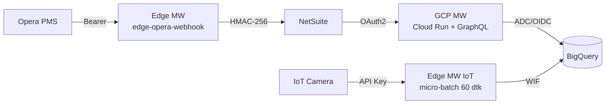

# Distributed Hospitality Ecosystem – Assessment

| Path | Isi |
|---|---|
| `edge-opera-webhook/` | M1: `server.js`, `edge-webhook.service`, `linux-commands.md`, `mock-netsuite.js` |
| `edge-iot-receiver/` | M2: `server.js` (API key + micro-batching), `edge-iot.service` |
| `gcp-middleware/` | M3: schema/resolver GraphQL, DataLoader, Secret Manager, `Dockerfile` |
| `sql/` | M4: `schema.sql` (DDL), `conversion_rate_query.sql`, `sample_data/*.jsonl` |
| `docs/architecture.md` | Diagram Mermaid: arsitektur, sequence webhook, alur DataLoader, star schema |

**Menjalankan lokal (mock mode, tanpa GCP/NetSuite):** `cp .env.example .env && npm i && npm start` di tiap folder
(M1 juga: `npm run mock-netsuite`; set `FAIL_RATE=0.5` untuk melihat retry). GraphQL: `POST localhost:8080/graphql`.
**Module 4 (BigQuery Sandbox, tanpa billing):** jalankan `sql/schema.sql` sekali; muat tiap `sql/sample_data/<tabel>.jsonl` ke tabelnya (JSONL, mode *Append*; DML/`INSERT` diblokir di free tier, load job diizinkan); lalu jalankan `sql/conversion_rate_query.sql` → 3 transaksi / 52 pengunjung = 5,77 %.

**Catatan pengujian (ngrok / webhook.site).** *Masuk:* `ngrok http 3000` membuka webhook lokal di URL HTTPS publik untuk mensimulasikan Opera PMS yang memanggil dari luar jaringan lokal (dengan Bearer token baru hasil generate, bukan nilai contoh): request dijawab `202` dalam < 60 ms dan body yang diulang menghasilkan `duplicate:true`. *Keluar:* `NETSUITE_URL` diarahkan ke URL webhook.site untuk memeriksa header `X-Signature`, `X-Timestamp`, `X-Nonce`, dan `Idempotency-Key`; tanda tangan dihitung ulang secara independen dengan `openssl dgst -sha256 -hmac` dan hasilnya cocok. ngrok hanya alat uji – di produksi server Edge berada di belakang firewall/reverse proxy hotel (TLS, IP allow-list, atau jalur privat).

## 1. Idempotency (Module 1)
Opera (atau retry jaringan) dapat mengirim event yang sama lebih dari sekali, dan pengiriman kita ke NetSuite juga dapat diulang.
1. **Key**: header `Idempotency-Key` jika dikirim Opera; jika tidak, SHA-256 dari raw body. (Produksi: pakai event/folio id dari Opera, karena dua body yang memang identik akan dianggap satu.)
2. **Outbox yang tahan crash**: key menjadi `PRIMARY KEY` tabel SQLite; `INSERT OR IGNORE` membuat duplikat tidak berefek, dan webhook tetap menjawab `202` (`duplicate:true`). Baris di-commit *sebelum* kita menjawab, sehingga crash tidak menghilangkan event yang sudah diterima.
3. **Worker background** menandatangani (`HMAC-SHA256(secret, timestamp.nonce.body)` → `X-Signature`) lalu mengirim. Sukses → `sent`; timeout/5xx/429 → exponential backoff + jitter; 4xx lain atau batas percobaan habis → `dead` (ditinjau manual). Baris yang tertinggal `processing` setelah crash dikembalikan ke `pending` saat boot (at-least-once).
4. `Idempotency-Key` yang sama diteruskan ke NetSuite agar sisi NetSuite dapat membuang retry kita → efektif sekali (effectively-once).

## 2. Autentikasi BigQuery untuk Edge IoT on-premise (Module 2)
**Workload Identity Federation (WIF) + service-account impersonation – tanpa JSON key berumur panjang di server.**
- Server edge membuktikan identitasnya ke identity provider yang kita percaya (OIDC IdP on-prem/Keycloak, atau sertifikat klien X.509 / mTLS); Google STS menukar kredensial itu dengan token berumur pendek yang meng-impersonate service account khusus `sa-iot-edge`.
- `gcloud iam workload-identity-pools create-cred-config … --output-file=wif-credential-config.json`; file ini **tidak berisi rahasia**; `GOOGLE_APPLICATION_CREDENTIALS` menunjuk ke file itu dan klien BigQuery memakainya lewat ADC.
- Least privilege: `sa-iot-edge` hanya mendapat `roles/bigquery.dataEditor` pada **satu tabel/dataset** (insert tidak butuh `jobUser`); attribute condition pada pool membatasi host edge mana yang boleh memakainya.
- Cadangan jika tidak ada IdP: service-account key di `/etc/…` (mode 600, dimiliki `edgeapp`), dirotasi tiap 90 hari – dicatat sebagai opsi yang lebih lemah.
- **Micro-batching**: tiap request disimpan di buffer SQLite lokal (dijawab 202); tiap 60 dtk timer mengirim hingga 500 baris per panggilan `insert` dan baru menghapusnya setelah BigQuery mengonfirmasi. Jika BigQuery mati, baris tetap di buffer dan dicoba lagi pada tick berikutnya. `insertId = event_id` memberi de-duplikasi retry secara best-effort; tabel fact juga bisa di-de-dup lewat `event_id`.
- *Catatan:* **sandbox BigQuery tidak mendukung streaming insert** – gunakan `BQ_MODE=mock`, atau ganti ke load job, untuk pengujian di free tier.

## 3. GCP: OIDC, IAM, dan Secret Manager (Module 3)
**Compute: Cloud Run** (container stateless, scale to zero, HTTPS bawaan, integrasi mudah dengan Secret Manager/IAM; GKE terlalu besar untuk satu API).
- **Tanpa JSON key**: Cloud Run berjalan sebagai *runtime service account* khusus `sa-graphql-mw`. Library mengambil token berumur pendek untuknya dari metadata server (ADC) – workload identity platform (berbasis OIDC/JWT) yang menandatangani. Role: `bigquery.dataViewer` (dataset), `bigquery.jobUser` (project), `bigquery.dataEditor` hanya pada tabel fact NetSuite, `secretmanager.secretAccessor` pada satu secret.
- **Akses masuk**: deploy dengan `--no-allow-unauthenticated`; backend BI / pemanggil NetSuite mengirim **OIDC ID token** yang ditandatangani Google (audience = URL service) dan memerlukan `roles/run.invoker`.
- **CI/CD**: GitHub Actions mengautentikasi dengan WIF (token OIDC GitHub → kredensial berumur pendek), jadi proses deploy juga tanpa key.
- **Secret Manager**: `tokenUrl/clientId/clientSecret` OAuth2 NetSuite disimpan sebagai satu secret JSON `netsuite-oauth`. Aplikasi membaca `projects/
/secrets/netsuite-oauth/versions/latest` saat runtime (`secrets.js`), meng-cache 5 menit, menyimpan access token hanya di memori, dan tidak pernah mencatatnya di log. Di produksi, kunci ke versi tertentu; rotasi dengan menambah versi baru (versi lama dinonaktifkan); akses diaudit lewat Cloud Audit Logs. Alternatif: `gcloud run deploy --set-secrets`.

## 4. Mitigasi N+1 dengan DataLoader (Module 3)
Query `transactions { location { name } visitorsAtLocationThatDay }` atas *N* transaksi secara naif menjalankan *N* lookup lokasi + *N* query pengunjung ke BigQuery (BigQuery ditagih per query dan lambat, jadi ini mahal).
`createLoaders()` (satu set **per request**, tanpa kebocoran cache antar pengguna) mendefinisikan dua loader. Setiap `loader.load(key)` dalam tick yang sama dikumpulkan, **di-de-duplikasi**, lalu diteruskan ke satu fungsi batch yang menjalankan satu query `WHERE … IN UNNEST(@ids)` dan mengembalikan hasil sesuai urutan key. Terverifikasi di log server: 6 transaksi → **1** query lokasi + **1** query pengunjung; `dailyMetrics` untuk 9 kombinasi lokasi-hari → **1** query pengunjung.

## 5. Star schema (Module 4)
Dua fact (`fact_transactions`, `fact_iot_camera_events`) berbagi dimensi yang sama (`dim_location`, `dim_date`). Dipartisi menurut tanggal, di-cluster menurut `location_id`. Query conversion rate mengagregasi tiap fact ke level *lokasi × tanggal* **sebelum** di-join agar tidak terjadi fan-out.

## Asumsi
Memakai mock environment (tanpa Opera/NetSuite/GCP asli); format payload/HMAC NetSuite diasumsikan (`timestamp.nonce.body`); `Transactions` di GraphQL diambil dari NetSuite sesuai soal (di produksi dapat dibaca dari `fact_transactions`).
