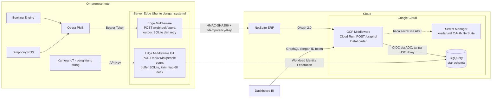
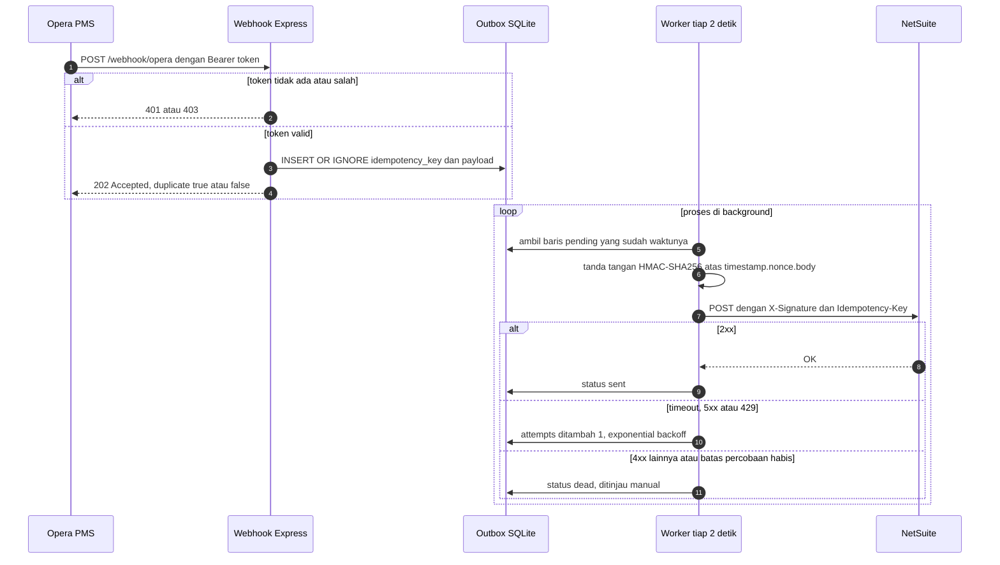
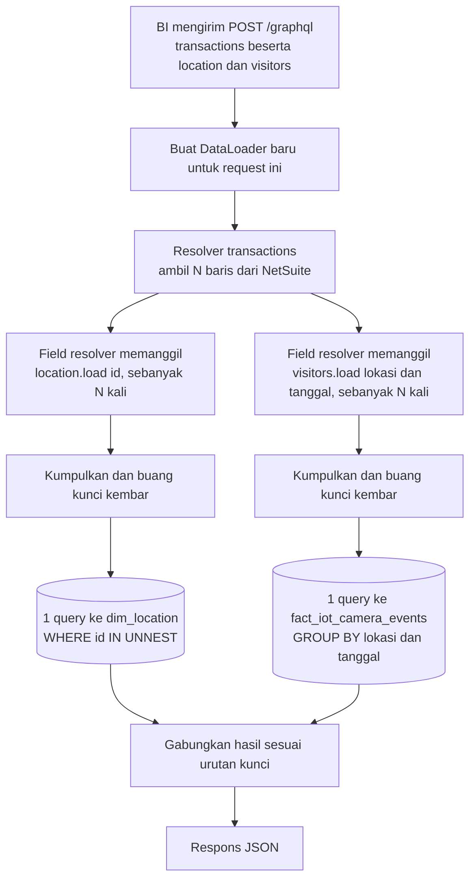
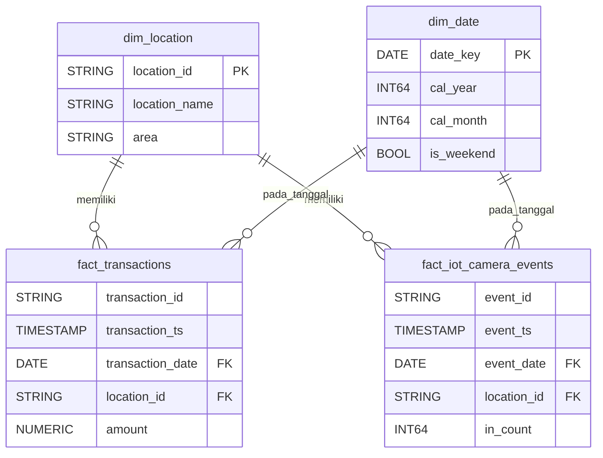

# Diagram Arsitektur (Mermaid)

GitHub dan GitLab menampilkan blok di bawah ini sebagai gambar secara otomatis.

**Untuk melihatnya di https://mermaid.live:** buka salah satu file di folder `diagrams/` (`*.mmd`), salin **seluruh isinya**, lalu tempel. Jangan menempel file ini, karena berisi teks lain dan lebih dari satu diagram.

*Catatan: nama tabel, nama kolom, endpoint, dan istilah teknis sengaja dibiarkan dalam bahasa Inggris karena sama persis dengan yang ada di kode.*

## 1. Arsitektur end-to-end dan autentikasi di setiap hop

## 2. Module 1: webhook, proses async, dan idempotency

## 3. Module 3: request GraphQL dengan batching DataLoader

## 4. Module 4: star schema

