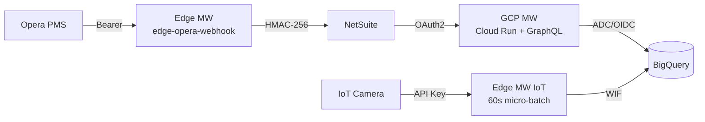

# Distributed Hospitality Ecosystem – Assessment

| Path | Content |
|---|---|
| `edge-opera-webhook/` | M1: `server.js`, `edge-webhook.service`, `linux-commands.md`, `mock-netsuite.js` |
| `edge-iot-receiver/` | M2: `server.js` (API key + micro-batching), `edge-iot.service` |
| `gcp-middleware/` | M3: GraphQL schema/resolvers, DataLoaders, Secret Manager, `Dockerfile` |
| `sql/` | M4: `schema.sql` (DDL), `conversion_rate_query.sql`, `sample_data/*.jsonl` |
| `docs/architecture.md` | Mermaid diagrams: architecture, webhook sequence, DataLoader flow, star schema |

**Run locally (mock mode, no GCP/NetSuite needed):** `cp .env.example .env && npm i && npm start` in each folder
(M1 also: `npm run mock-netsuite`; set `FAIL_RATE=0.5` to watch retries). GraphQL: `POST localhost:8080/graphql`.
**Module 4 (BigQuery Sandbox, no billing):** run `sql/schema.sql` once; load each `sql/sample_data/<table>.jsonl` into its table (JSONL, *Append*; DML/`INSERT` is blocked in the free tier, load jobs are allowed); then run `sql/conversion_rate_query.sql` → 3 transactions / 52 visitors = 5.77 %.

## 1. Idempotency (Module 1)
Opera (or a network retry) may deliver the same event more than once, and our own push to NetSuite may be retried.
1. **Key**: `Idempotency-Key` header if Opera sends one, otherwise SHA-256 of the raw body. (Production: use Opera's event/folio id, since two legitimately identical bodies would collapse.)
2. **Durable outbox**: the key is the `PRIMARY KEY` of a SQLite table; `INSERT OR IGNORE` makes duplicates a no-op and the webhook still answers `202` (`duplicate:true`). The row is committed *before* we answer, so a crash cannot lose an accepted event.
3. **Background worker** signs (`HMAC-SHA256(secret, timestamp.nonce.body)` → `X-Signature`) and pushes. Success → `sent`; timeout/5xx/429 → exponential backoff + jitter; other 4xx or max attempts → `dead` (manual review). Rows stuck in `processing` after a crash are reset to `pending` on boot (at-least-once).
4. The same `Idempotency-Key` is forwarded to NetSuite so *its* side can de-duplicate our retries → effectively-once.

## 2. BigQuery authentication for the on-prem IoT edge (Module 2)
**Workload Identity Federation (WIF) + service-account impersonation – no long-lived JSON key on the server.**
- The edge server proves its identity to an identity provider we trust (on-prem OIDC IdP/Keycloak, or an X.509 client certificate / mTLS); Google STS exchanges that credential for a short-lived token that impersonates a dedicated service account `sa-iot-edge`.
- `gcloud iam workload-identity-pools create-cred-config … --output-file=wif-credential-config.json`; the file contains **no secret**; `GOOGLE_APPLICATION_CREDENTIALS` points to it and the BigQuery client uses it via ADC.
- Least privilege: `sa-iot-edge` gets `roles/bigquery.dataEditor` on the **single table/dataset only** (insert needs no `jobUser`); the pool's attribute condition restricts which edge host may use it.
- Fallback if no IdP exists: a service-account key in `/etc/…` (mode 600, owned by `edgeapp`), rotated every 90 days – documented as the weaker option.
- **Micro-batching**: each request is stored in a local SQLite buffer (202 returned); every 60 s a timer sends up to 500 rows per `insert` call and deletes them only after BigQuery acknowledges. BigQuery down → rows stay buffered and are retried next tick. `insertId = event_id` gives best-effort de-duplication of retries; the fact table is also de-dupable by `event_id`.
- *Note:* the BigQuery **sandbox does not allow streaming inserts** – use `BQ_MODE=mock`, or switch to load jobs, for free-tier testing.

## 3. GCP: OIDC, IAM and Secret Manager (Module 3)
**Compute: Cloud Run** (stateless container, scales to zero, HTTPS built in, easy Secret Manager/IAM integration; GKE would be over-sized for one API).
- **No JSON keys**: Cloud Run runs as a dedicated *runtime service account* `sa-graphql-mw`. Libraries obtain short-lived tokens for it from the metadata server (ADC) – the platform's workload identity (OIDC/JWT-based) does the signing. Roles: `bigquery.dataViewer` (dataset), `bigquery.jobUser` (project), `bigquery.dataEditor` only on the NetSuite fact table, `secretmanager.secretAccessor` on the one secret.
- **Inbound**: deploy with `--no-allow-unauthenticated`; the BI backend / NetSuite caller sends a Google-signed **OIDC ID token** (audience = service URL) and needs `roles/run.invoker`.
- **CI/CD**: GitHub Actions authenticates with WIF (GitHub OIDC token → short-lived credentials), so deployments need no keys either.
- **Secret Manager**: NetSuite OAuth2 `tokenUrl/clientId/clientSecret` are stored as one JSON secret `netsuite-oauth`. The app reads `projects/
/secrets/netsuite-oauth/versions/latest` at runtime (`secrets.js`), caches it 5 min, keeps the access token in memory only, never logs it. Pin a version in production, rotate by adding a new version (old one disabled), access is audited via Cloud Audit Logs. Alternative: `gcloud run deploy --set-secrets`.

## 4. N+1 mitigation with DataLoader (Module 3)
Query `transactions { location { name } visitorsAtLocationThatDay }` over *N* transactions would naively run *N* location lookups + *N* BigQuery visitor queries (BigQuery is per-query priced and slow, so this is costly).
`createLoaders()` (one set **per request**, no cross-user cache leaks) defines two loaders. Every `loader.load(key)` made in the same tick is collected, **de-duplicated**, and passed to one batch function, which runs a single `WHERE … IN UNNEST(@ids)` query and returns results in key order. Verified in the server log: 6 transactions → **1** location query + **1** visitor query; `dailyMetrics` over 9 location-days → **1** visitor query.

## 5. Star schema (Module 4)
Two facts (`fact_transactions`, `fact_iot_camera_events`) share conformed dimensions (`dim_location`, `dim_date`). Partitioned by date, clustered by `location_id`. The conversion query aggregates each fact to *location × date* **before** joining to avoid fan-out.

## Assumptions
Mock environments are used (no real Opera/NetSuite/GCP); NetSuite payload/HMAC format is assumed (`timestamp.nonce.body`); GraphQL `Transactions` are pulled from NetSuite per the brief (in production they could be read from `fact_transactions`).
